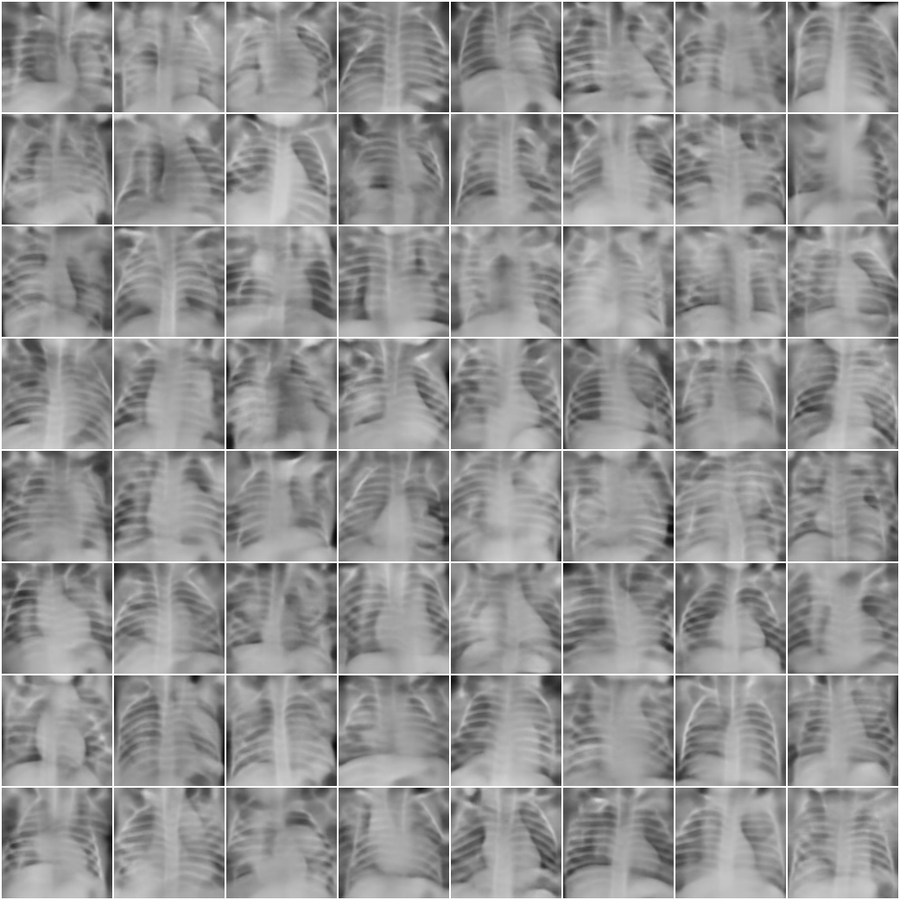
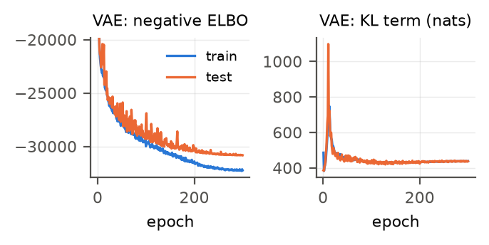
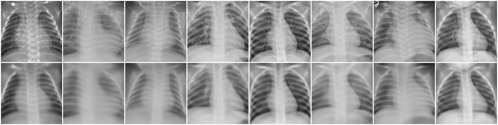

# VAE for Chest X-ray Generation

A convolutional variational autoencoder (VAE) in PyTorch, trained on the
[Kaggle chest X-ray (pneumonia) dataset](https://www.kaggle.com/paultimothymooney/chest-xray-pneumonia)
to generate 128x128 chest radiographs. Generated images are evaluated with Inception Score and FID
using [PyTorch-Ignite](https://pytorch-ignite.ai/blog/gan-evaluation-with-fid-and-is/).



## Files
| File | Purpose |
|---|---|
| `prepare_data.py` | Converts images to grayscale, center-crops, resizes to 128x128, and caches them as `.npz` |
| `model.py` | VAE architecture and loss (`sigma`: Gaussian decoder with optimal shared variance; `bce`; `mse`) |
| `train.py` | Training loop. Writes `vae.pt`, `history.json`, `config.json` and sample grids |
| `evaluate.py` | IS / FID with `ignite.metrics`, plus sample and reconstruction figures |
| `plot_curves.py` | Plots train/test loss curves from `history.json` |

## Setup
```bash
pip install -r requirements.txt
```
For a CUDA build of PyTorch, follow the instructions at https://pytorch.org/get-started/locally/.

## Reproduce
1. Download the dataset from Kaggle and unzip it, so that the folder contains `train/`, `val/` and `test/`.
2. Run:
```bash
python prepare_data.py --root <path>/chest_xray --out ../data_cache --size 128
python train.py --recon sigma --aug --epochs 300 --out ../runs/sigma_aug
python evaluate.py --runs ../runs/sigma_aug --out ../results
python plot_curves.py --runs ../runs/sigma_aug --out ../results/loss_curves.pdf
```
Training takes about 15 minutes on one RTX 5070 Ti laptop GPU.

## Model and hyperparameters
- Encoder: five stride-2 4x4 convolutions (32-64-128-256-512 channels, BatchNorm, LeakyReLU), then linear heads for mu and log-variance
- Decoder: mirror image of the encoder using transposed convolutions, with a sigmoid output (8.7M parameters in total)
- Latent dimension 128, prior N(0, I)
- Gaussian likelihood with a shared variance set to its optimal value, sigma^2 = MSE (the "sigma-VAE", Rybkin et al., 2021)
- KL weight beta = 1, warmed up linearly over the first 10 epochs
- Adam, learning rate 1e-3 with a one-cycle cosine schedule, batch size 64, 300 epochs
- Augmentation: random rotation of +/-5 degrees, shift of +/-5%, and zoom of +/-5%; no horizontal flips



## Results
Both metrics are computed against the 5,216 real training images.

| Image set | N | IS | FID |
|---|---|---|---|
| Real test images (reference) | 624 | 2.31 | 22.9 |
| Uniform noise (sanity check) | 624 | 1.03 | 427.4 |
| VAE reconstructions of test images | 624 | 1.91 | 104.0 |
| VAE samples, z ~ N(0, I) | 624 | 1.58 | 205.1 |
| VAE samples, z ~ N(0, I) | 5216 | 1.58 | 191.5 |

Note: by default, ignite's `FID()` uses the 1000-d softmax output of InceptionV3 as its features.
That gives tiny values that carry no information: uniform noise scores about 0.09.
`evaluate.py` therefore passes the standard 2048-d pool features (`InceptionModel(return_features=True)`).

Reconstructions (top row: test images, bottom row: reconstructions):


